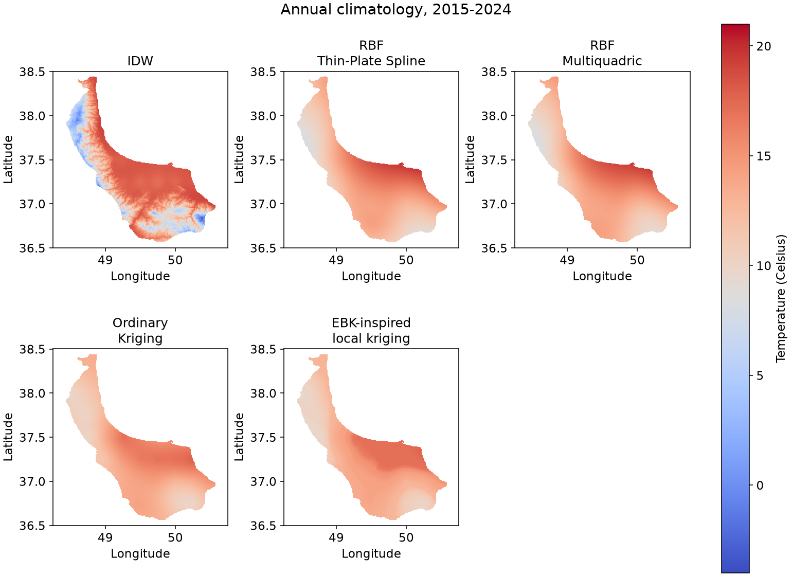

# Spatial Temperature Interpolation in Gilan Province

**Seyedamir Rahmani** · Iran University of Science and Technology (IUST)  
Supervisor: Mahboubeh Molavi-Arabshahi

This supervised undergraduate study adapts the comparative framework of [Yang and Xing (2021)](https://doi.org/10.3390/atmos12101318) to reconstruct annual and seasonal ERA5 temperature climatologies in Gilan Province, Iran (2015–2024).

[Research report (PDF)](report/research_report.pdf) · [Notebook](spatial_interpolation.ipynb) · [Data instructions](data/README.md)

## Methods and results

Five fixed configurations are compared at 23 ERA5 grid locations using leave-one-location-out cross-validation (575 predictions) and entropy-weighted TOPSIS: elevation-adjusted IDW, thin-plate and multiquadric RBF, ordinary kriging, and EBK-inspired local kriging (a heuristic, not conventional EBK).

| Method | Annual MAE (°C) | RMSE (°C) | NSE |
|---|---:|---:|---:|
| IDW | 0.746 | 0.886 | 0.874 |
| RBF thin-plate | 0.612 | 0.852 | 0.884 |
| RBF multiquadric | **0.323** | **0.425** | **0.971** |
| Ordinary kriging | 1.099 | 1.423 | 0.675 |
| EBK-inspired local kriging | 1.002 | 1.290 | 0.733 |

Multiquadric RBF has the lowest MAE in four of five climatologies; IDW is virtually tied with it in winter. Winter TOPSIS rankings depend on the criteria used.



The maps show all five configurations. IDW target elevations use documented SRTM GL1 v3 data obtained through OpenTopography's public mirror on 27 November 2026. Replacing the historical DEM changed IDW maps by an RMSE of 0.057 °C (maximum absolute change 0.546 °C); the verified numerical evaluation is unchanged.

## Reproduce

Tested with Python 3.14.0 on Windows. Obtain the input files using [data/README.md](data/README.md).

```sh
python -m pip install -r requirements.txt
python -m unittest -v
python analysis.py --no-maps
```

For full mapping, run `python download_dem.py` (six public SRTM tiles; no registration), then prepare them following the data instructions and run `python analysis.py`. The notebook provides an interactive workflow. Detailed predictions, metrics and rankings are in `results/`. The authoritative report source is `report/research_report.tex`; `python prepare_documents.py` builds its PDF using pdfLaTeX.

## Scope and limitations

Validation reconstructs withheld reanalysis grid values, not independent weather-station measurements. Findings are specific to the small spatial sample, fixed configurations and climatologies studied. The fine mapping grid does not add observational resolution. See the report for the mathematical methods, limitations and ranking sensitivity.

## License and acknowledgment

Original software is released under the [MIT License](LICENSE), subject to any separately identified third-party terms. Data, maps and the report are not licensed by the software license. GADM raw boundaries are not redistributed. Contains modified Copernicus Climate Change Service information (ERA5, 2015–2024; [dataset](https://doi.org/10.24381/cds.f17050d7)). Neither the European Commission nor ECMWF is responsible for use of the information. Elevation source: NASA SRTM GL1 v3, [distributed by OpenTopography](https://doi.org/10.5069/G9445JDF); [USGS SRTM product overview](https://doi.org/10.5066/F7PR7TFT). The author acknowledges supervision by Mahboubeh Molavi-Arabshahi at IUST.
